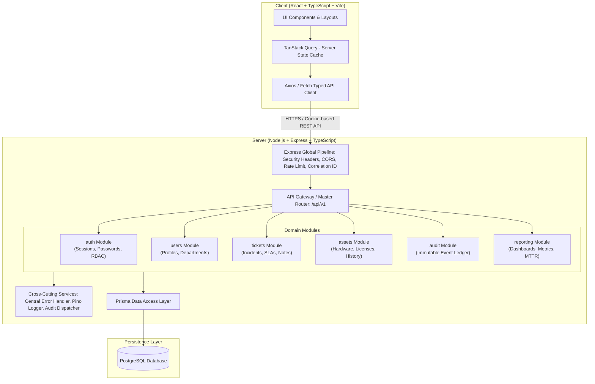
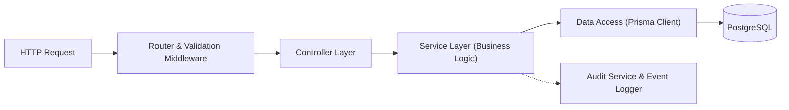
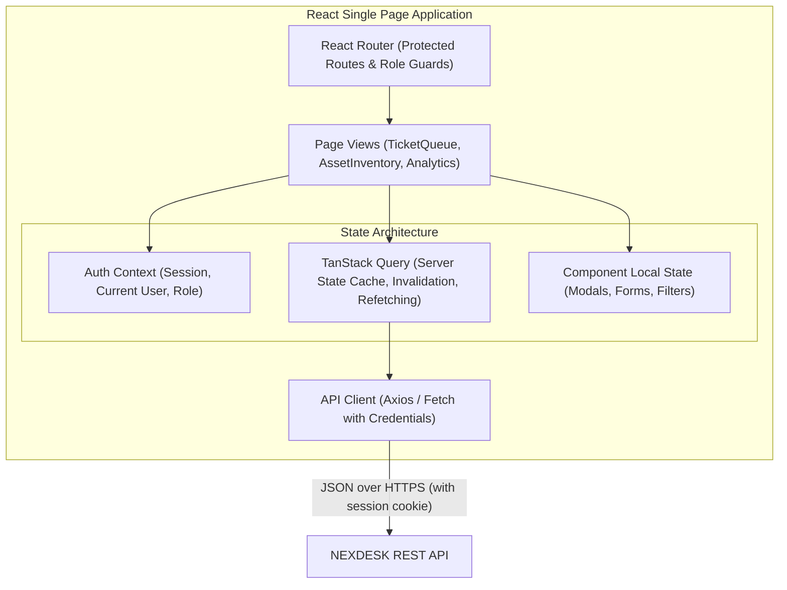

# NEXDESK — Enterprise IT Service Management & Asset Intelligence Platform
## System Architecture & Technical Design Document

**Document Version:** 1.0.0  
**Status:** Approved Baseline  
**Phase:** 1 — Architecture & Specifications  
**Author:** AI Project Orchestrator & Senior Software Architect  

---

## 1. Architectural Strategy & Blueprint

### 1.1 Architectural Pattern: The Modular Monolith
NEXDESK adopts a **Modular Monolith** architecture. While running as a single, unified deployment process, the system enforces strict logical separation between business subdomains. 

This architecture guarantees:
* **High Developer Ergonomics**: Single repository, instant local debugging without orchestrating multiple microservices, unified TypeScript type safety end-to-end.
* **Guaranteed Relational Integrity**: Database transactions span multiple domain aggregates atomically (e.g. updating an asset status while simultaneously creating an asset assignment history record).
* **Future Microservice Readiness**: Each module is self-contained with its own domain logic, schemas, and routes, allowing future extraction into standalone microservices if traffic or organizational scaling dictates.



---

## 2. Monorepo Repository Structure

The project organizes code into clean, isolated workspaces:

```
nexdesk/
├── docs/                         # Architectural blueprints, PRDs, ADRs, and API specifications
│   ├── adr/                      # Architectural Decision Records
│   ├── requirements.md
│   ├── architecture.md
│   ├── data-model.md
│   ├── api-specification.md
│   └── security.md
├── packages/                     # (Optional shared packages or types)
│   └── shared/                   # Shared TypeScript DTOs, Enums, Zod validation contracts
├── client/                       # Frontend application (React 18+, TypeScript, Vite)
│   ├── src/
│   │   ├── assets/               # Static images, icons, and styling variables
│   │   ├── components/           # Reusable UI primitives (Buttons, Modals, Forms, Tables)
│   │   ├── features/             # Feature-sliced modules (tickets, assets, auth, dashboard)
│   │   ├── hooks/                # Custom React hooks (useAuth, useSlaCountdown, useToast)
│   │   ├── layouts/              # AppShell, Sidebar, Header, RoleGate
│   │   ├── lib/                  # TanStack Query client, Axios instance, formatters
│   │   ├── pages/                # Route page components
│   │   ├── types/                # Frontend-specific type definitions
│   │   ├── App.tsx
│   │   └── main.tsx
│   ├── index.html
│   ├── tailwind.config.ts
│   ├── tsconfig.json
│   └── vite.config.ts
├── server/                       # Backend application (Node.js, Express, TypeScript, Prisma)
│   ├── src/
│   │   ├── common/               # Framework infrastructure & shared utilities
│   │   │   ├── config/           # Validated environment variables (Zod-checked)
│   │   │   ├── errors/           # RFC 7807 AppError hierarchy
│   │   │   ├── middleware/       # authenticate, requireRole, validateRequest, rateLimiter
│   │   │   └── utils/            # logger (Pino), id generators, password hasher
│   │   ├── modules/              # Self-contained business domains
│   │   │   ├── auth/             # auth.router, auth.controller, auth.service, auth.schemas
│   │   │   ├── users/            # user.router, user.controller, user.service
│   │   │   ├── tickets/          # ticket.router, ticket.controller, ticket.service
│   │   │   ├── assets/           # asset.router, asset.controller, asset.service
│   │   │   ├── audit/            # audit.service, audit.router
│   │   │   └── reporting/        # reporting.router, reporting.service
│   │   ├── app.ts                # Express application factory & middleware registration
│   │   └── server.ts             # Process bootstrapper, port listening, graceful shutdown
│   ├── prisma/
│   │   ├── schema.prisma         # Prisma data schema & relations
│   │   ├── migrations/           # Versioned SQL migration files
│   │   └── seed.ts               # Synthetic development seed data
│   ├── tests/                    # Integration and unit tests
│   └── tsconfig.json
├── docker-compose.yml            # Local PostgreSQL container definition
├── .gitignore
├── package.json                  # Root monorepo workspace configuration
└── README.md
```

---

## 3. Server Architecture: Layered Module Pattern

Each domain module in `server/src/modules/<domain>/` adheres to a strict four-tier unidirectional data flow:



1. **Router Layer (`<domain>.routes.ts`)**: Defines HTTP verbs and paths, binds middleware (session authentication, RBAC authorization, and Zod schema validation).
2. **Controller Layer (`<domain>.controller.ts`)**: Pure HTTP adapter. Parses incoming `req.params`, `req.query`, and validated `req.body`, invokes the service layer, and writes standardized HTTP responses.
3. **Service Layer (`<domain>.service.ts`)**: Pure business logic. Orchestrates domain rules, checks resource ownership, calculates SLA deadlines, triggers audit records, and wraps multi-table operations in database transactions.
4. **Data Access Layer (`Prisma`)**: Interacts directly with PostgreSQL using generated type-safe client methods.

---

## 4. Frontend Architecture & State Management



* **Server State**: Managed strictly through **TanStack Query**. Mutations (e.g., ticket creation or asset status update) automatically trigger selective query key invalidation (`['tickets']`, `['assets']`), keeping the UI synchronized without full page reloads.
* **Client State**: Minimalist. Global user authentication state is managed through a lightweight React Context or Zustand store.
* **Component Design**: UI elements are built around accessible, unstyled primitives (Radix UI) styled with utility classes via Tailwind CSS.

---

## 5. Cross-Cutting Infrastructure Concerns

### 5.1 Correlation IDs & Request Tracing
Every incoming HTTP request is assigned a unique `x-request-id` (UUIDv7 or nanoid) generated by middleware. If the client supplies an existing `x-request-id`, it is sanitized and propagated. This ID is attached to:
* All structured Pino log lines emitted during the request lifecycle.
* All resulting audit log entries.
* The response headers returned to the client (`X-Request-ID`), allowing developers to correlate frontend errors with backend log traces instantly.

### 5.2 Centralized Error Handling (RFC 7807)
All errors inherit from a custom `AppError` base class. Unhandled exceptions are intercepted by a global Express error middleware:

```json
{
  "type": "https://api.nexdesk.internal/errors/validation-failed",
  "title": "Unprocessable Entity",
  "status": 422,
  "detail": "The request payload failed input schema validation.",
  "instance": "/api/v1/tickets",
  "requestId": "018d9f10-7b24-7100-84a1-5231ef6b1c40",
  "invalidParams": [
    {
      "name": "priority",
      "reason": "Expected 'LOW' | 'MEDIUM' | 'HIGH' | 'URGENT', received 'SUPER_CRITICAL'"
    }
  ]
}
```

### 5.3 Logging & Security Redaction
Backend logging uses **Pino** for high-throughput, structured JSON output. A custom redaction pipeline ensures secrets, passwords, cookies, authorization tokens, and payment/personal data are automatically replaced with `[REDACTED]` before writing to stdout.

---

## 6. Local Development Infrastructure

Local development leverages **Docker Compose** to run a containerized PostgreSQL 16 database, ensuring identical behavior across developer environments without requiring manual system-level database installations.

```yaml
version: '3.8'
services:
  postgres:
    image: postgres:16-alpine
    container_name: nexdesk-postgres
    restart: always
    environment:
      POSTGRES_USER: nexdesk_user
      POSTGRES_PASSWORD: dev_password_never_commit_to_prod
      POSTGRES_DB: nexdesk_dev
    ports:
      - "5432:5432"
    volumes:
      - nexdesk_pgdata:/var/lib/postgresql/data

volumes:
  nexdesk_pgdata:
```
