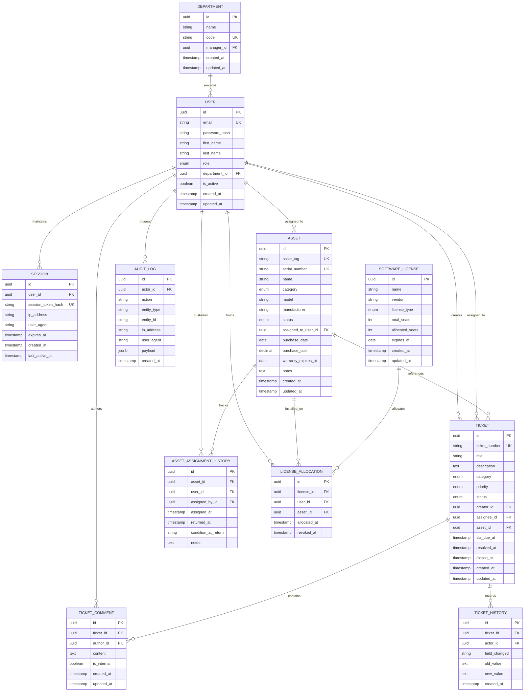

# NEXDESK — Enterprise IT Service Management & Asset Intelligence Platform
## Relational Data Model & Database Architecture

**Document Version:** 1.0.0  
**Status:** Approved Baseline  
**Phase:** 1 — Architecture & Specifications  
**Author:** AI Project Orchestrator & Senior Software Architect  

---

## 1. Entity-Relationship Overview

NEXDESK's persistence model connects two primary enterprise domains: **Service Management (Tickets & Workflows)** and **Asset Intelligence (Hardware & Software Inventory)**, backed by a unified User & RBAC directory and an immutable Audit Trail.

---

## 2. Detailed Entity & Column Specifications

### 2.1 Identity & Access Entities

#### `users` Table
Stores authentication credentials, profile metadata, and system security privileges.
* `id` (`UUID`, Primary Key, default `gen_random_uuid()` or UUIDv7)
* `email` (`VARCHAR(255)`, Unique, Not Null, lowercased & trimmed)
* `password_hash` (`VARCHAR(255)`, Not Null) — Argon2id or bcrypt hash
* `first_name` (`VARCHAR(100)`, Not Null)
* `last_name` (`VARCHAR(100)`, Not Null)
* `role` (`ENUM`, Not Null) — `'EMPLOYEE' | 'IT_AGENT' | 'TEAM_LEAD' | 'ADMIN'`
* `department_id` (`UUID`, Nullable, Foreign Key -> `departments.id` ON DELETE SET NULL)
* `is_active` (`BOOLEAN`, Not Null, Default `true`) — Soft-deactivation flag
* `created_at` (`TIMESTAMPTZ`, Not Null, Default `NOW()`)
* `updated_at` (`TIMESTAMPTZ`, Not Null, Default `NOW()`)

#### `sessions` Table
Tracks active authenticated sessions for revocation and concurrent session limits.
* `id` (`UUID`, Primary Key)
* `user_id` (`UUID`, Not Null, Foreign Key -> `users.id` ON DELETE CASCADE)
* `session_token_hash` (`VARCHAR(64)`, Unique, Not Null) — SHA-256 hash of the random cryptographically secure token
* `ip_address` (`VARCHAR(45)`, Nullable) — IPv4 or IPv6 string
* `user_agent` (`TEXT`, Nullable)
* `expires_at` (`TIMESTAMPTZ`, Not Null)
* `last_active_at` (`TIMESTAMPTZ`, Not Null, Default `NOW()`)
* `created_at` (`TIMESTAMPTZ`, Not Null, Default `NOW()`)

#### `departments` Table
Organizational grouping for users and hardware inventory.
* `id` (`UUID`, Primary Key)
* `name` (`VARCHAR(120)`, Not Null)
* `code` (`VARCHAR(20)`, Unique, Not Null) — e.g. `'ENG'`, `'FIN'`, `'HR'`
* `manager_id` (`UUID`, Nullable, Foreign Key -> `users.id` ON DELETE SET NULL)
* `created_at` (`TIMESTAMPTZ`, Not Null, Default `NOW()`)
* `updated_at` (`TIMESTAMPTZ`, Not Null, Default `NOW()`)

---

### 2.2 Incident & Service Management Entities

#### `tickets` Table
Primary entity representing service requests and operational incidents.
* `id` (`UUID`, Primary Key)
* `ticket_number` (`VARCHAR(32)`, Unique, Not Null) — Human-readable identifier (e.g. `TSK-10001`)
* `title` (`VARCHAR(200)`, Not Null)
* `description` (`TEXT`, Not Null)
* `category` (`ENUM`, Not Null) — `'HARDWARE' | 'SOFTWARE' | 'NETWORK' | 'ACCESS' | 'OTHER'`
* `priority` (`ENUM`, Not Null) — `'LOW' | 'MEDIUM' | 'HIGH' | 'URGENT'`
* `status` (`ENUM`, Not Null, Default `'NEW'`) — `'NEW' | 'ASSIGNED' | 'IN_PROGRESS' | 'PENDING_USER' | 'RESOLVED' | 'CLOSED'`
* `creator_id` (`UUID`, Not Null, Foreign Key -> `users.id` ON DELETE RESTRICT)
* `assignee_id` (`UUID`, Nullable, Foreign Key -> `users.id` ON DELETE SET NULL)
* `asset_id` (`UUID`, Nullable, Foreign Key -> `assets.id` ON DELETE SET NULL) — Optional link to malfunctioning hardware
* `sla_due_at` (`TIMESTAMPTZ`, Not Null) — Resolution deadline derived from priority matrix
* `resolved_at` (`TIMESTAMPTZ`, Nullable)
* `closed_at` (`TIMESTAMPTZ`, Nullable)
* `created_at` (`TIMESTAMPTZ`, Not Null, Default `NOW()`)
* `updated_at` (`TIMESTAMPTZ`, Not Null, Default `NOW()`)

#### `ticket_comments` Table
Conversation thread on a ticket with private/public visibility flags.
* `id` (`UUID`, Primary Key)
* `ticket_id` (`UUID`, Not Null, Foreign Key -> `tickets.id` ON DELETE CASCADE)
* `author_id` (`UUID`, Not Null, Foreign Key -> `users.id` ON DELETE RESTRICT)
* `content` (`TEXT`, Not Null)
* `is_internal` (`BOOLEAN`, Not Null, Default `false`) — When `true`, visible only to `IT_AGENT`, `TEAM_LEAD`, and `ADMIN`
* `created_at` (`TIMESTAMPTZ`, Not Null, Default `NOW()`)
* `updated_at` (`TIMESTAMPTZ`, Not Null, Default `NOW()`)

#### `ticket_history` Table
Immutable chronological record of ticket modifications (status changes, reassignments).
* `id` (`UUID`, Primary Key)
* `ticket_id` (`UUID`, Not Null, Foreign Key -> `tickets.id` ON DELETE CASCADE)
* `actor_id` (`UUID`, Not Null, Foreign Key -> `users.id` ON DELETE RESTRICT)
* `field_changed` (`VARCHAR(64)`, Not Null) — e.g. `'status'`, `'assignee_id'`, `'priority'`
* `old_value` (`TEXT`, Nullable)
* `new_value` (`TEXT`, Nullable)
* `created_at` (`TIMESTAMPTZ`, Not Null, Default `NOW()`)

---

### 2.3 IT Asset Management (ITAM) Entities

#### `assets` Table
Physical and network hardware tracking.
* `id` (`UUID`, Primary Key)
* `asset_tag` (`VARCHAR(64)`, Unique, Not Null) — e.g. `'AST-00912'`
* `serial_number` (`VARCHAR(128)`, Unique, Not Null)
* `name` (`VARCHAR(150)`, Not Null) — e.g. `'MacBook Pro 16" M3'`
* `category` (`ENUM`, Not Null) — `'LAPTOP' | 'DESKTOP' | 'MONITOR' | 'PHONE' | 'PERIPHERAL' | 'SERVER' | 'NETWORK_EQUIPMENT' | 'OTHER'`
* `model` (`VARCHAR(100)`, Not Null)
* `manufacturer` (`VARCHAR(100)`, Not Null) — e.g. `'Apple'`, `'Dell'`, `'Lenovo'`
* `status` (`ENUM`, Not Null, Default `'IN_STOCK'`) — `'IN_STOCK' | 'ASSIGNED' | 'IN_REPAIR' | 'RETIRED' | 'LOST'`
* `assigned_to_user_id` (`UUID`, Nullable, Foreign Key -> `users.id` ON DELETE SET NULL)
* `purchase_date` (`DATE`, Nullable)
* `purchase_cost` (`NUMERIC(12, 2)`, Nullable)
* `warranty_expires_at` (`DATE`, Nullable)
* `notes` (`TEXT`, Nullable)
* `created_at` (`TIMESTAMPTZ`, Not Null, Default `NOW()`)
* `updated_at` (`TIMESTAMPTZ`, Not Null, Default `NOW()`)

#### `asset_assignment_history` Table
Permanent custody audit trail for physical assets.
* `id` (`UUID`, Primary Key)
* `asset_id` (`UUID`, Not Null, Foreign Key -> `assets.id` ON DELETE CASCADE)
* `user_id` (`UUID`, Not Null, Foreign Key -> `users.id` ON DELETE RESTRICT)
* `assigned_by_id` (`UUID`, Not Null, Foreign Key -> `users.id` ON DELETE RESTRICT)
* `assigned_at` (`TIMESTAMPTZ`, Not Null, Default `NOW()`)
* `returned_at` (`TIMESTAMPTZ`, Nullable)
* `condition_at_return` (`VARCHAR(100)`, Nullable) — e.g. `'EXCELLENT'`, `'GOOD'`, `'DAMAGED_SCREEN'`
* `notes` (`TEXT`, Nullable)

#### `software_licenses` & `license_allocations` Tables
Enterprise software license entitlement and seat pool tracking.
* **`software_licenses`**:
  * `id` (`UUID`, Primary Key)
  * `name` (`VARCHAR(150)`, Not Null) — e.g. `'JetBrains All Products Pack'`
  * `vendor` (`VARCHAR(100)`, Not Null)
  * `license_type` (`ENUM`, Not Null) — `'PERPETUAL' | 'SUBSCRIPTION' | 'SEAT_BASED'`
  * `total_seats` (`INT`, Not Null)
  * `allocated_seats` (`INT`, Not Null, Default `0`)
  * `expires_at` (`DATE`, Nullable)
  * `created_at`, `updated_at` (`TIMESTAMPTZ`)
* **`license_allocations`**:
  * `id` (`UUID`, Primary Key)
  * `license_id` (`UUID`, Not Null, Foreign Key -> `software_licenses.id` ON DELETE RESTRICT)
  * `user_id` (`UUID`, Not Null, Foreign Key -> `users.id` ON DELETE RESTRICT)
  * `asset_id` (`UUID`, Nullable, Foreign Key -> `assets.id` ON DELETE SET NULL)
  * `allocated_at` (`TIMESTAMPTZ`, Not Null, Default `NOW()`)
  * `revoked_at` (`TIMESTAMPTZ`, Nullable)

---

### 2.4 Governance & Audit Entities

#### `audit_logs` Table
Append-only tamper-resistant record of security and administrative operations.
* `id` (`UUID`, Primary Key)
* `actor_id` (`UUID`, Nullable, Foreign Key -> `users.id` ON DELETE SET NULL)
* `action` (`VARCHAR(100)`, Not Null) — e.g. `'TICKET_STATUS_UPDATED'`, `'ASSET_ASSIGNED'`, `'USER_ROLE_CHANGED'`
* `entity_type` (`VARCHAR(50)`, Not Null) — e.g. `'Ticket'`, `'Asset'`, `'User'`
* `entity_id` (`VARCHAR(64)`, Not Null)
* `ip_address` (`VARCHAR(45)`, Nullable)
* `user_agent` (`TEXT`, Nullable)
* `payload` (`JSONB`, Nullable) — Delta of changed fields or context parameters
* `created_at` (`TIMESTAMPTZ`, Not Null, Default `NOW()`)

---

## 3. Indexing & Query Optimization Strategy

| Table | Index Columns | Index Type | Query Optimization Rationale |
| :--- | :--- | :--- | :--- |
| `users` | `(email)` | UNIQUE B-Tree | High-frequency login credential lookup |
| `sessions` | `(session_token_hash)` | UNIQUE B-Tree | Per-request session authentication check |
| `tickets` | `(status, assignee_id)` | Compound B-Tree | Agent active queue query: `WHERE status != 'CLOSED' AND assignee_id = ?` |
| `tickets` | `(status, sla_due_at)` | Compound B-Tree | SLA risk monitor: identifies imminent breaches ordered by deadline |
| `tickets` | `(creator_id, created_at)` | Compound B-Tree | Employee dashboard: `WHERE creator_id = ? ORDER BY created_at DESC` |
| `assets` | `(asset_tag)`, `(serial_number)` | UNIQUE B-Tree | Barcode scanning & quick asset resolution |
| `assets` | `(status, category)` | Compound B-Tree | Inventory filters for available hardware stock |
| `audit_logs` | `(created_at DESC)` | B-Tree | Chronological audit log browsing |
| `audit_logs` | `(entity_type, entity_id)` | Compound B-Tree | Entity-specific audit history lookup |

---

## 4. Referential Integrity & Deletion Discipline

* **No Destructive Cascading Deletions on Primary Data**: Deleting a `User` must **never** cascade-delete their historical tickets, asset records, or comments. Foreign keys use `ON DELETE RESTRICT` or `ON DELETE SET NULL`.
* **Soft Deactivation (`is_active = false`)**: User accounts are deactivated rather than deleted to ensure full historical traceability.
* **Append-Only Auditing**: The `audit_logs` table has no `UPDATE` or `DELETE` triggers or API endpoints. It serves as an immutable operational ledger.
